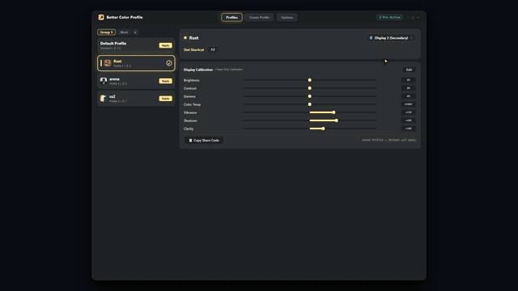

  

<h1 align="center">Better Color Profile</h1>

  <em>🌐 The modern Windows color profile manager</em>

  
  
  
  
  

---

**Better Color Profile** is a lightweight, modern display calibration and color profile manager for **Windows 11 and 10**.

Easily tune monitor colors, organize profiles into quick-access slots, and switch profiles instantly while gaming with global hotkeys and a sleek in-game overlay — with **zero input lag** and **no game-process interaction**.

👉 **[📥 Download Latest Installer](https://github.com/KOUKOU221/BetterColorProfile/releases/latest/download/BetterColorProfileSetup.exe)** • **[🌐 Visit Official Website](https://bettercolorprofile.vercel.app/)**

---

  

---

## ✨ Features at a Glance

### ⚡ Profiles & Quick Slots
- **Custom Slots**: Save your favorite profiles into slots for instant access.
- **One-Click Apply**: Switch profiles immediately without digging through Windows settings.
- **Multi-Monitor Support**: Assign different color profiles to each connected display.
- **Protected Defaults**: Your original Windows sRGB calibration is safely preserved so you can always revert.

### 🎛️ Real-Time Display Calibration & Profile Creator
Fine-tune your display with 7 live hardware sliders:
- **Brightness & Contrast**: Clean hardware luminance and contrast adjustments.
- **Gamma**: Adjust midtones for clear visibility in any lighting.
- **Color Temperature**: Warm (2500K) to cool (10000K) eye-comfort balance.
- **Digital Vibrance**: Boost color saturation on NVIDIA & AMD GPUs.
- **Shadows (Black Equalizer)**: Lift dark areas in competitive games without washing out highlights.
- **Clarity**: Enhance micro-contrast for sharp textures and crisp edges.

### 📋 Share Codes
- **Copy Share Code**: Generate a compact code (e.g. `BCP-XXXX-...`) for any calibration preset to share with friends.
- **Import Share Code**: Paste any code to instantly apply those exact slider settings.

### 🎮 In-Game HUD Overlay
Tweak colors and switch profiles inside any game without Alt-Tabbing (`RCtrl + Enter`):
- `Ctrl + Up / Down` — Select a slider or profile row
- `Ctrl + Left / Right` — Adjust values (±5%) or switch profiles
- `Ctrl + Shift + Left / Right` — Fine-tune values (±1%)
- `Ctrl + S` — Save adjustments to the active profile
- `Ctrl + Shift + S` — Save adjustments as a new profile
- `Esc` or `RCtrl + Enter` — Close overlay

### 🪟 Auto Window & Game Detection
- Automatically activates your chosen profile when a specific game or app launches.
- Restores your default desktop profile as soon as you close or switch away from the game.

### ⌨️ Global Shortcuts
- **Cycle Hotkey**: `Ctrl + Shift + C` (or any custom key) to cycle through saved profile slots anywhere in Windows.
- **Direct Slot Hotkeys**: Assign dedicated shortcuts (e.g. `F1`, `F2`, `Ctrl + 1`) to jump straight to a profile.
- **Keycode Diagnostics**: Built-in test box confirms key codes and international layout compatibility.

### 🛡️ Uses Official Windows Display & Calibration APIs
- Interacts only with display output via the standard Windows Color System (`mscms.dll`) and GPU hardware gamma LUT (via `SetDeviceGammaRamp`).
- **Does not inspect, read, or modify game memory, processes, or DLLs.**
- No DLL injection, no kernel-mode drivers, and no background CPU usage while gaming.
- Compatible with Riot Vanguard, Easy Anti-Cheat, BattlEye, and Ricochet because it operates exclusively at the display driver layer, not inside game processes.

---

## 💬 Community & Support

Join our official Discord community to share monitor calibrations, download game presets, and get support:

👉 **[Join the Discord](https://discord.gg/eeVBnK7Hmg)**

---

## 📄 License

**Better Color Profile** is proprietary commercial software (Paid Service with Free Trial). All rights reserved.
- Official plans, licenses, and key management: [bettercolorprofile.vercel.app](https://bettercolorprofile.vercel.app/#pricing).

Copyright © 2026 KOUKOU221. All rights reserved.

---

  <a href="https://github.com/KOUKOU221/BetterColorProfile"><strong>⭐ Star this repo</strong></a>

